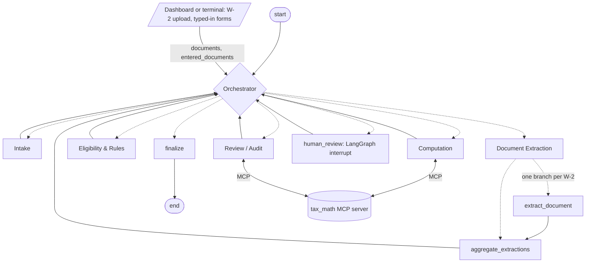

# SilverFile

A multi-agent preparation aid for Form 1040-SR, the U.S. Income Tax Return for Seniors (tax year
2025), built for Kushim. SilverFile gathers a client's information, drafts the return, and
records where every number came from so a person at Kushim can review it.

SilverFile never files anything and never gives tax advice. Anything out of scope, any conflict
between documents and answers, and any request for advice goes to a human.

## Status

| Component | Owner | In this repo |
|---|---|---|
| Orchestrator | Verena | Done: hub-and-spoke routing, task ledger, loop guard, human review step, graph wiring |
| Intake | Jordan | Done: one-question-at-a-time interview, corrections, resumable sessions, clarification requests from other agents, escalation detection |
| Document Extraction | Yassine | W-2 extraction agent done (LangGraph nodes, tests) |
| Eligibility & Rules | David | Done: decision table grounded in `data/policy.md`, LangGraph node, tests |
| Computation | Brendan | Done: `tax_math` MCP server and the Computation agent, tests |
| Review / Audit | Marco | Done: independent re-check of every computed line, 3-round revision loop, wired into the graph |
| Document registration, session runner, draft form, dashboard (`src/app/`) | Unassigned (written by Jordan during integration; see `docs/TEAM_REVIEW_SUMMARY.md`) | Done: W-2 upload, typed-in forms, terminal session, Streamlit dashboard, draft Form 1040-SR with click-through provenance |

## Team roles

| Focus area | Team member assigned |
|---|---|
| Agent memory | Jordan |
| Inter agent communication | Brendan |
| Task division and management | Verena |
| MLOps/DevOps | David |
| Guardrails and ethics | Marco |
| Security | Yassine |

## Setup

Requires Python 3.11 or newer (tested with 3.12 and 3.13).

```bash
python -m venv .venv
```

Activate it: `.venv\Scripts\activate` on Windows, or `source .venv/bin/activate` on macOS and
Linux. Then:

```bash
pip install -r requirements.txt
```

### API key (only for reading new W-2 images)

Only the Document Extraction agent calls an AI model: it reads W-2 photos with Anthropic's
vision model. To read W-2 images of your own, you need your own Anthropic API key:

1. Create a key at [console.anthropic.com](https://console.anthropic.com) (API Keys).
2. Copy `.env.example` to `.env` (`cp .env.example .env`, or `copy .env.example .env` on
   Windows).
3. Open `.env` and set `ANTHROPIC_API_KEY=` to your key. Never commit `.env`; it is git-ignored.

Reading one W-2 makes a single model call and costs a few cents.

**No key?** Everything else works without one. Add `--offline` to any command (for example
`python run.py dashboard --offline`) and the demo W-2s in `demo/` are read from the ground
truth stored next to each image. Both eval cases, the dashboard and all tests run this way.
`--offline` cannot read a W-2 image it hasn't seen before; that needs the key.

If `import pydantic` fails with `cannot import name 'ArgsKwargs'`, the virtual environment's
compiled files are damaged (seen once after copying a venv): delete `.venv` and create it again.

## Running

### The whole system

```bash
python run.py dashboard              # web dashboard: taxpayer view and Kushim preparer view
python run.py dashboard --offline    # same, reading the demo W-2s with the offline test reader
```

Open the URL it prints (default http://localhost:8501).

- **Taxpayer** view: upload W-2 images (JPG, PNG or WEBP), type in SSA-1099, 1099-INT, 1099-DIV
  and 1099-R boxes, then answer the questions one at a time. Note the session code to come back
  later: reopening it shows a summary of what was covered and continues at the same question.
- **Kushim preparer** view: every saved session and its state; the open issues of a paused
  session with the allowed decisions; the draft Form 1040-SR, where clicking any amount shows the
  tool that produced it, its inputs, the working, the source documents and the rule citations;
  and the audit record (task ledger, route taken, escalations, human decisions).

The same in a terminal:

```bash
python run.py session --session demo_1 --w2 demo/w2_image_1.jpg --forms demo/eval_case_1_forms.json --offline
python run.py review --session demo_1     # if the run pauses for a preparer
python run.py session --session demo_1 --offline   # carry on after the preparer decides
```

Leave out `--offline` to have the vision model read the W-2. `--answers FILE` answers the
questions from a file, one per line. The draft is written to `out/<session>_1040sr.html`.
Sessions are saved in `data/sessions.sqlite`; uploaded images in `data/uploads/` (both kept out
of git).

### Evaluation cases

- [demo/eval_case_1.md](demo/eval_case_1.md): a clean run to an approved draft.
- [demo/eval_case_2.md](demo/eval_case_2.md): a human-in-the-loop run (spouse died in 2025)
  and how to resolve it.

### Individual agents

```bash
python run.py tax-math-server                                    # tax_math MCP server on stdin/stdout
python data/generate_fixtures.py                                 # fake W-2 images
python run.py extract demo/w2_image_1.jpg demo/w2_image_2.jpg    # needs an API key in .env
python run.py extract demo/w2_image_1.jpg --offline              # no key needed
python run.py eligibility data/fixtures/eligibility_clean_mfj.json
python run.py eligibility data/fixtures/eligibility_spouse_died.json --resolve married_filing_jointly
python run.py intake --session demo_taxpayer_001                 # the interview on its own
```

`run.py intake` runs Intake's own graph. Use a different session ID from the full-system
sessions, because both use `data/sessions.sqlite` by default.

## Run with Docker

Docker lets you run SilverFile without installing Python or anything else it needs. These steps
assume no programming experience. You only need to do steps 1 to 4 once.

### 1. Install Docker Desktop

1. Go to https://www.docker.com/products/docker-desktop/ and download Docker Desktop for your
   computer:
   - **Mac:** pick "Apple Silicon" if your Mac has an M1, M2, M3 or newer chip, or "Intel chip"
     otherwise. To check, click the Apple menu > **About This Mac** and look at "Chip" or
     "Processor".
   - **Windows:** pick "Windows - AMD64" (almost every Windows PC).
2. Open the downloaded file and follow the installer. On a Mac, drag Docker into the
   Applications folder. On Windows, keep the default options; if it asks to install or update
   WSL, say yes and restart the computer when asked.
3. Open **Docker Desktop** (from Applications on a Mac, or the Start menu on Windows). Accept the
   terms; you can skip signing in. Wait until it says Docker is running (a green status at the
   bottom left of its window).

Docker Desktop must be open whenever you use SilverFile.

### 2. Download SilverFile

1. Go to https://github.com/bjs327/assignment7 (if you see "404", ask the team to give your
   GitHub account access, then sign in).
2. Click the green **Code** button, then **Download ZIP**.
3. Find the ZIP in your Downloads folder and double-click it (on Windows, right-click > **Extract
   All**). This makes a folder called `assignment7-main`. Move it somewhere easy to find, such as
   your Desktop.

If you already use Git, `git clone https://github.com/bjs327/assignment7.git` does the same.

### 3. Open a terminal in the SilverFile folder

A terminal is a window where you type commands.

- **Mac:** open **Terminal** (press `Cmd+Space`, type "Terminal", press Enter). Type `cd `
  (with a space after it), drag the `assignment7-main` folder from Finder into the Terminal
  window, and press Enter.
- **Windows:** open the `assignment7-main` folder in File Explorer, click in the address bar at
  the top, type `powershell` and press Enter. A window opens already inside the folder.

To check you are in the right place, type `ls` and press Enter: you should see `Dockerfile`,
`README.md` and `docker-compose.yml` in the list.

### 4. (Optional) Add an API key

Without a key, SilverFile only reads the demo W-2 images in the `demo` folder, which is enough to
try it out. To read your own W-2 photos, it needs an Anthropic API key
(https://console.anthropic.com/, see "API key" above for details):

1. In the SilverFile folder, make a copy of `.env.example` and name the copy `.env` (just a dot
   and "env", with nothing after it). On a Mac, files starting with a dot are hidden in Finder;
   press `Cmd+Shift+.` to show them. Or run this in the terminal instead:
   `cp .env.example .env` on a Mac, `copy .env.example .env` on Windows.
2. Open `.env` in a text editor (TextEdit or Notepad), find the line `ANTHROPIC_API_KEY=` and
   paste your key right after the `=`, like this: `ANTHROPIC_API_KEY=sk-ant-...`. Save the file.

Never share the `.env` file or upload it anywhere.

### 5. Start SilverFile

In the terminal from step 3, type this and press Enter:

```bash
docker compose up --build
```

The first time takes a few minutes while Docker downloads and installs everything; later starts
take seconds. When you see `You can now view your Streamlit app in your browser`, open
http://localhost:8501 in your web browser.

To stop SilverFile, click the terminal window and press `Ctrl+C`. Your saved sessions are kept
for next time.

### 6. Or use it in the terminal instead of the browser

You can also do the whole interview by typing in the terminal, without the web page. Do steps 1
to 4 first, then build SilverFile once (this takes a few minutes the first time):

```bash
docker compose build
```

**Try the demo.** This runs a made-up couple (eval case 1) with the demo W-2 and forms:

```bash
docker compose run --rm silverfile session --session try1 --w2 demo/w2_image_1.jpg --forms demo/eval_case_1_forms.json --offline
```

SilverFile asks one question at a time. Type your answer after the `>` and press Enter. For the
demo, use the answers in [demo/eval_case_1.md](demo/eval_case_1.md) (filing status
`married filing jointly`, SSN `900-12-3456`, and so on). To see the whole run without typing,
add `--answers demo/eval_case_1_answers.txt` to the end of the command.

What the parts of the command mean:

- `--session try1` is the name of your session. Pick any name without spaces. Use a new name to
  start a new return; use the same name to come back to one.
- `--w2 demo/w2_image_1.jpg` is a W-2 photo. Repeat it for each W-2
  (`--w2 first.jpg --w2 second.jpg`).
- `--forms demo/eval_case_1_forms.json` is a file with the amounts from your other forms
  (SSA-1099, 1099-INT, 1099-DIV, 1099-R). Copy that file and change the amounts for your own.
- `--offline` reads only the demo W-2s, with no API key. Leave it out to read your own W-2 photos
  (this needs the key from step 4).

**Using your own W-2 photo or forms file:** put the file in the SilverFile folder, run
`docker compose build` again so Docker can see it, and use its name in the command, for example
`--w2 my_w2.jpg`.

**Stopping and coming back:** press `Ctrl+C` at any question. Your answers are saved; run the
same command again with the same session name to carry on where you left off.

**When it's done**, it prints `Draft Form 1040-SR written to out/try1_1040sr.html`. Open the `out`
folder inside the SilverFile folder and double-click that file to see the draft in your browser.

**If a person needs to check something** (for example, a spouse who died during the year), it
prints `This session is waiting for a Kushim preparer`. The preparer reviews it with:

```bash
docker compose run --rm silverfile review --session try1
```

They pick a decision for each issue by typing its number. Then run the `session` command again
with the same session name to finish. (The message on screen shows these commands starting with
`python run.py`; with Docker, use `docker compose run --rm silverfile` in its place.) Eval case 2
walks through this: [demo/eval_case_2.md](demo/eval_case_2.md).

### Using it again later

Open Docker Desktop, open a terminal in the SilverFile folder (step 3), and run
`docker compose up` again. If you downloaded a newer version of SilverFile, use
`docker compose up --build` so Docker picks up the changes.

### If something goes wrong

- **`docker: command not found`** or **`'docker' is not recognized`**: Docker Desktop isn't
  installed, or the terminal was opened before installing it. Close the terminal and open a new
  one.
- **`Cannot connect to the Docker daemon`** or **`error during connect`**: Docker Desktop isn't
  running. Open it, wait until it shows as running, and try again.
- **`no configuration file provided: not found`**: the terminal isn't in the SilverFile folder.
  Repeat step 3.
- **`port is already allocated`**: SilverFile (or something else) is already running on port
  8501. Close other terminals running SilverFile, or run `docker compose down`, then try again.
- **The page at http://localhost:8501 won't load**: wait a little longer, the app may still be
  starting. Check the terminal for an error message.

### More Docker commands

Any other `run.py` command runs in a one-off container, with the same arguments as in "Running" above:

```bash
docker compose run --rm silverfile session --session demo_1 --w2 demo/w2_image_1.jpg --forms demo/eval_case_1_forms.json --offline
docker compose run --rm silverfile review --session demo_1
docker compose run --rm silverfile pytest                     # the test suite
```

Where the data goes:

- Saved sessions are kept in the `silverfile-state` volume and uploaded W-2 images in
  `silverfile-uploads`, so they survive restarts. `docker compose down -v` deletes both.
- Draft forms are written to `out/` on your machine.
- `.env`, `.venv`, saved sessions and uploads are never copied into the image (see
  `.dockerignore`).

Rebuild with `docker compose up --build` after changing the code or `requirements.txt`. Run
`docker compose up -d` to start the dashboard in the background and `docker compose down` to stop
it.

## Tests

```bash
python -m pytest
```

About 790 tests, no API key needed: `tax_math`, every agent, the full graph through the
Orchestrator (loop guard, bounded review loop, human review, resuming after a restart), the two
eval cases end to end, and the dashboard driven headlessly. See
[docs/INTEGRATION_TEST_REPORT.md](docs/INTEGRATION_TEST_REPORT.md) for the latest run.

## Context-window measurement

```bash
python run.py batch --compare                 # strategy off and on; writes docs/metrics.md
python run.py batch --no-context-strategy     # one run with the whole transcript kept
```

Runs 10 returns one after another through the full graph (no API key needed) and records each
item's input context with and without the strategy. Results: [docs/metrics.md](docs/metrics.md).

## Orchestration

Hub and spoke: only the Orchestrator chooses the next step, and every agent hands control back
to it. All agents share one LangGraph state (`src/state.py`), checkpointed after every step
(`src/memory.py`), so a session can pause for a person or the taxpayer and resume later.



Dashed edges are conditional: the Orchestrator picks the first task whose inputs are ready, from
its task ledger. The graph shows the required patterns (specification section 4.1):

- **Conditional routing** from state (`task_ledger`, each agent's status), not a fixed sequence.
- **Parallel branch with aggregation**: one `extract_document` branch per W-2, merged by the
  `merge_extractions` and `merge_escalation_records` reducers.
- **Bounded cycle**: Review sends work back at most three times, then a person decides.
- **Loop guard**: a hand-off pattern repeated three times since a person last stepped in pauses
  the run for human review (`tests/orchestrator/test_graph.py`).

The Orchestrator's own notes explain the choice of topology:
[docs/IMPLEMENTATION_NOTES.md](docs/IMPLEMENTATION_NOTES.md#orchestrator-verena).

## Repository layout

```
├── README.md
├── requirements.txt
├── .env.example
├── run.py                       command-line entry point
├── pytest.ini
├── Dockerfile, docker-compose.yml, docker-entrypoint.sh   the container (see "Run with Docker")
├── src/                         import root: code imports tax_math, state, agents.intake, ...
│   ├── state.py                 shared state and reducers
│   ├── graph.py                 LangGraph wiring
│   ├── memory.py                checkpointer and context-window strategy
│   ├── agents/                  the six agents
│   ├── app/                     document registration, session runner, draft form, dashboard
│   ├── security/                SSN validation, masking and redaction
│   └── tax_math/                deterministic 2025 arithmetic and its MCP server
├── data/
│   ├── generate_fixtures.py     fake W-2 images with ground-truth JSON
│   ├── policy.md                reference corpus: computation and eligibility rules
│   └── fixtures/
├── evals/cases.json             the two eval cases, machine-readable
├── tests/
├── traces/
├── docs/                        implementation notes, AI disclosure, metrics, integration reports
└── demo/                        eval cases, demo W-2 images, answer and form files
```

Still to add: the demo video.

## More detail

- [docs/IMPLEMENTATION_NOTES.md](docs/IMPLEMENTATION_NOTES.md): how each component works.
- [data/policy.md](data/policy.md): the rules the agents cite.
- [docs/AI_DISCLOSURE.md](docs/AI_DISCLOSURE.md): how the team used AI.
- [docs/INTEGRATION_CHANGELOG.md](docs/INTEGRATION_CHANGELOG.md),
  [docs/INTEGRATION_TEST_REPORT.md](docs/INTEGRATION_TEST_REPORT.md),
  [docs/TEAM_REVIEW_SUMMARY.md](docs/TEAM_REVIEW_SUMMARY.md): the end-to-end integration work.
